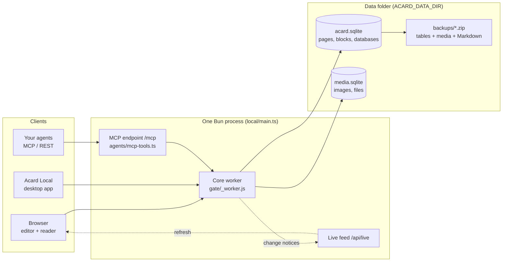

<p align="center"><a href="README.md">English</a> · <b>한국어</b> · <a href="README.zh-CN.md">简体中文</a></p>

<p align="center">
  
</p>

<p align="center">
  <b>Acard 는 로컬로 돌릴 수 있는 오픈 노션입니다.</b><br>
  페이지·블록·데이터베이스를 빠른 편집기로 쓰고, 내 컴퓨터나 사내망의 작은 서버 하나가 그 모두를 맡습니다.
</p>

<p align="center">
  <a href="docs/install-server.md">서버 설치</a> ·
  <a href="docs/install-client.md">기기 연결</a> ·
  <a href="https://github.com/Hakubisual/open-notion-acard/releases/latest">데스크톱 앱 받기</a> ·
  <a href="docs/why-acard.ko.md">왜 Acard 인가</a> ·
  <a href="docs/architecture.md">구조 (영문)</a>
</p>

---

## 무엇인가요

Acard 는 직접 운영하는 노션 스타일 작업 공간입니다. Bun 프로세스 하나가 편집기를 띄우고, 모든 내용을 데이터 폴더 하나의
SQLite 파일에 저장하며, 브라우저·데스크톱 앱(Acard Local)·내 AI 에이전트의 요청을 받습니다. 클라우드 기능을 직접 켜지
않는 한 어떤 데이터도 내 기기 밖으로 나가지 않습니다.

노트북 한 대에서 혼자 써도 되고, 사무실 LAN·홈랩·VPN 에 서버를 두고 팀이 함께 써도 됩니다.

## 왜 Acard 인가

| | Acard | Notion | Obsidian |
| --- | --- | --- | --- |
| 데이터 위치 | 내가 고른 폴더의 SQLite 파일 | Notion 클라우드 | 로컬 볼트의 마크다운 파일 |
| 팀용 서버 직접 운영 | 됨: 프로세스 하나, AGPL-3.0 | 안 됨 | 기본 기능 없음 (공유 볼트는 Obsidian Sync) |
| 블록 편집 + 데이터베이스 | 됨: 보기 7종, 관계, 롤업, 수식 | 됨 | 마크다운 노트, Bases 로 데이터베이스 보기 |
| AI 에이전트 읽기·쓰기 | 내 서버에 MCP·REST 내장 | Notion API·호스팅 MCP (Notion 클라우드) | 커뮤니티 플러그인 |
| 소스 코드 | 공개 (AGPL-3.0) | 비공개 | 앱 비공개, 플러그인 API 공개 |

Notion 과 Obsidian 은 둘 다 훌륭한 도구입니다. Acard 는 노션처럼 블록과 데이터베이스로 쓰고 싶지만 문서를 외부 서비스에
맡기고 싶지 않은 사람을 위한 선택입니다. 항목마다 근거 코드를 단 자세한 비교는 [docs/why-acard.ko.md](docs/why-acard.ko.md)
에 있습니다.

## 화면

| 데스크톱 | 모바일 |
| --- | --- |
|  |  |

<p align="center"></p>

## 동작 방식



블록·데이터베이스 모델, 동기화와 백업까지 자세한 설명은 [docs/architecture.md](docs/architecture.md)(영문)에 있습니다.

## 기능

- **블록 편집기**: 제목 1-4(접기 가능), 목록, 할 일, 토글, 인용, 콜아웃, 코드, 표, 수식, 이미지, 임베드. `/` 명령과 마크다운 단축키.
- **열**: 블록을 2-4단으로 나란히 놓고, 끌어 옮기고, 폭을 조절합니다.
- **블록 색**, 콜아웃 아이콘, 데이터베이스 행을 추가하는 **버튼**.
- **페이지 꾸미기**: 이모지·업로드 아이콘, 표지, 페이지 너비.
- **데이터베이스**: 표·보드·갤러리·목록·캘린더·타임라인·차트 보기, 필터, 정렬, 하위 항목, 양방향 관계, 사람·ID 속성, 행 템플릿(반복 예약 포함), 수식.
- **부품**: JSON 데이터로 그리는 차트·표·히트맵·배지·흐름도.
- **페이지 트리**: 하위 페이지, 폴더, 끌어 놓기, 즐겨찾기, 템플릿, 빠른 메모.
- **공유**: 페이지를 게시하거나 링크로 공유하면 깔끔한 읽기 전용 화면으로 보입니다.
- **마크다운 가져오기·내보내기**: 마크다운과 Notion 내보내기 파일을 그대로 가져옵니다.
- **전체 검색**: 모든 페이지 본문까지 찾습니다.
- **에이전트**: 로컬 MCP 엔드포인트와 REST API 로 내 스크립트·AI 에이전트가 페이지를 읽고 씁니다.
- **백업**: 모든 표·모든 파일·페이지별 마크다운 사본을 담은 zip 하나. 매일 자동 백업.
- **빠름**: 프런트엔드 프레임워크가 없고, 편집기·리더가 크기 예산을 넘으면 빌드가 실패합니다.
- **3개 언어**: 영어·한국어·중국어 간체 화면.

## 빠르게 시작하기

```sh
git clone https://github.com/Hakubisual/open-notion-acard.git
cd open-notion-acard
bun install
bun run build

# 이 컴퓨터에서만
ACARD_DATA_DIR=./data ACARD_APP_DIR=./dist ACARD_LANG=ko bun local/main.ts
# http://127.0.0.1:47811/ 접속
```

사내망에 공유하려면 `ACARD_HOST=0.0.0.0`, `ACARD_PASSWORD=...`, `ACARD_ALLOWED_HOSTS=<서버 IP>` 를 더하세요.
Windows·Linux 서비스 등록, 방화벽, 백업, 업데이트, HTTPS 는 [서버 설치 안내](docs/install-server.md)(영문)에 단계별로
있습니다. 다른 기기는 브라우저나 데스크톱 앱으로 접속합니다([접속 안내](docs/install-client.md), 영문).

## 데스크톱 앱: Acard Local

[최신 릴리스](https://github.com/Hakubisual/open-notion-acard/releases/latest)에서 `Acard-Local-Setup-<버전>.exe` 를 받으세요. 처음 켜면 서버 주소를 묻고,
그 주소에서 Acard 서버가 응답하는지 확인한 뒤 전용 창으로 엽니다. 호스팅판 Acard 앱과 따로 설치되어 서로 영향을 주지
않습니다.

> **Windows SmartScreen:** 설치 파일에 아직 코드 서명이 없어 *"Windows의 PC 보호"* 창이 뜰 수 있습니다.
> **추가 정보 → 실행** 을 누르거나, `desktop/` 에서 직접 빌드하세요(접속 안내 참고).

## 포함되지 않은 것

이 레포는 셀프호스트 핵심입니다. 호스팅 서비스에 기대는 기능은 들어 있지 않습니다: AI 글쓰기·다듬기, 채팅 에이전트와
작업 기록, 이메일·구글 계정, 관리 콘솔, 결제. 그 자리는 작은 중립 스텁(`gate/hosted-*.ts`, `features/ai-service.js`,
`local/edition.ts`)이 채워 핵심만으로 빌드·실행됩니다. 서버를 직접 돌리기 싫다면 [호스팅판
Acard](https://acard.dev) 를 쓰세요.

## 기여

버그 제보, 아이디어, 풀 리퀘스트 모두 환영합니다. [CONTRIBUTING.md](CONTRIBUTING.md) 부터 읽어 주세요. 보안 문제는
[SECURITY.md](SECURITY.md) 에 적힌 대로 비공개로 알려 주세요. 버전별 변경은 [CHANGELOG.md](CHANGELOG.md) 에 있습니다.

## OpenNotion 에서 이름이 바뀌었습니다

v0.1.0 까지는 OpenNotion 이라는 이름이었습니다. 데이터와 설정은 그대로 이어집니다: 서버는 같은 `ACARD_*` 설정과
데이터 폴더를 쓰고, `git pull` 은 GitHub 리디렉트로 새 주소를 따라가며, Acard Local 은 처음 켤 때 옛 데스크톱 앱에
저장된 서버 주소를 가져옵니다.

## 라이선스

[AGPL-3.0](LICENSE). 서드파티 고지: [THIRD_PARTY_NOTICES.md](THIRD_PARTY_NOTICES.md).

Acard 는 독립 오픈소스 프로젝트이며 Notion Labs, Inc. 나 Obsidian 개발사와 제휴·보증·후원 관계가 없습니다.
"Notion" 과 "Obsidian" 은 각 소유자의 상표이며, 여기서는 설명과 비교를 위해서만 씁니다.
