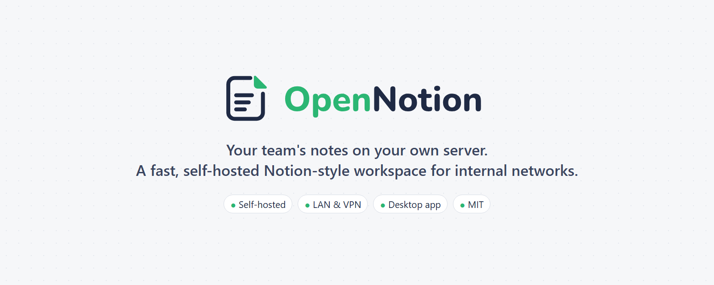
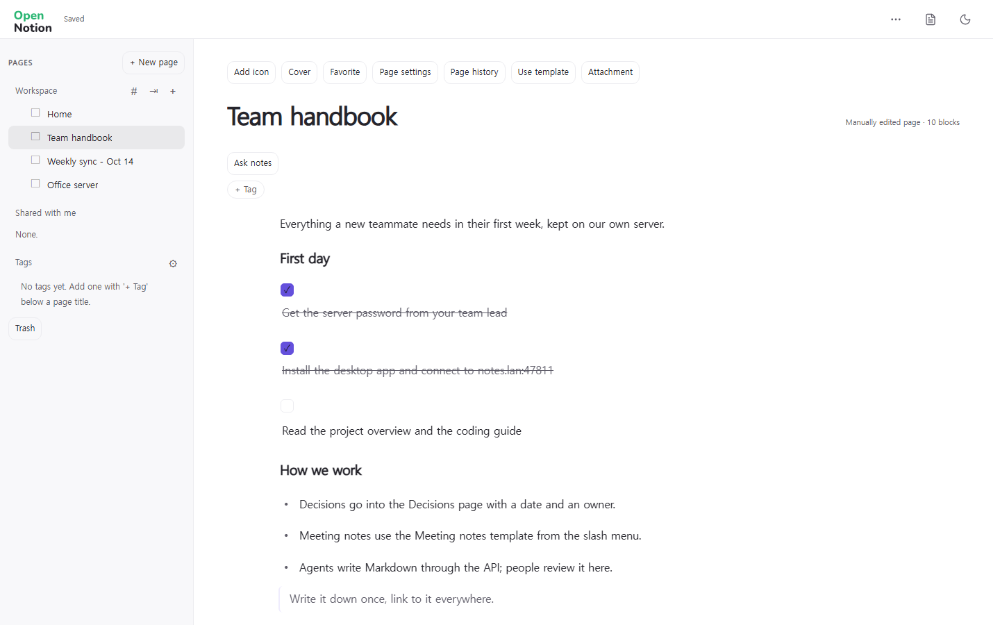
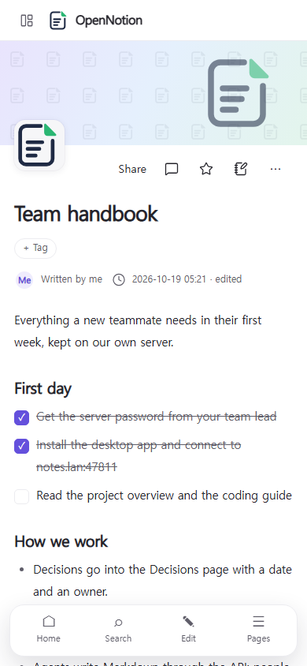
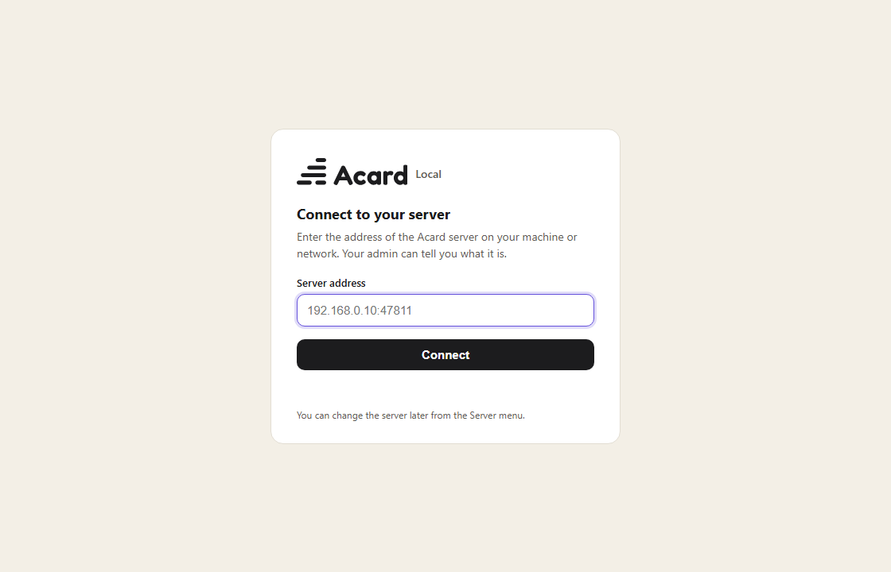

<p align="center">
  
</p>

<p align="center">
  <a href="https://acard.dev"></a><br>
  <b>Acard is built on OpenNotion.</b> Try the hosted version at <a href="https://acard.dev"><b>acard.dev</b></a> - no server needed.
</p>

<p align="center">
  <b>A fast, self-hosted Notion-style workspace for teams that run their own server on an internal network.</b><br>
  Pages, blocks and databases in the browser or a desktop app. Your data stays in one folder on your machine.
</p>

<p align="center">
  <a href="docs/install-server.md">Server install</a> ·
  <a href="docs/install-client.md">Client install</a> ·
  <a href="https://github.com/Hakubisual/open-notion/releases/latest">Download</a> ·
  <a href="LICENSE">MIT License</a>
</p>

---

## Who it is for

OpenNotion is for teams that keep a server inside their own network (an office LAN, a home lab, a VPN) and want a
Notion-like editor on it without sending documents to a cloud service. One machine runs the server; everyone else
opens it in a browser or in the desktop app.

If you would rather not run a server at all, the hosted version at [acard.dev](https://acard.dev) is the same editor
with accounts, sync, sharing and AI features managed for you. OpenNotion is the open, self-hosted core of it.

## Screenshots

| Desktop | Mobile |
| --- | --- |
|  |  |

<p align="center"></p>

## Features

- **Block editor** with headings 1-4 (any of them can fold like a toggle), lists, to-dos, toggles, quotes, callouts, code, tables, equations, images and embeds; `/` commands and Markdown shortcuts.
- **Columns**: put blocks side by side in 2-4 columns, drag blocks between them and resize them.
- **Block colors** for text and background, callout icons, and **buttons** that add a database row and open it.
- **Checklists** in lists and tables that can be ticked in the editor, the reader and on shared pages.
- **Page look**: an emoji or uploaded icon, a gradient or uploaded cover, and a per-page width (narrow, normal, wide).
- **Databases** with table, board, gallery, list, calendar, timeline and chart views, filters (including relative dates such as this week), sorting, sub-items, two-way relations, person and auto-numbered ID properties, button properties, row templates (also repeating on a schedule) and formulas (date functions, list methods, `let`, `ifs`, styled results).
- **Parts**: charts, tables, heatmaps, badges and flow diagrams drawn from JSON data that follow the page theme.
- **Page tree** with nested pages, folders, drag and drop in the sidebar, favorites, templates and quick notes.
- **Sharing**: publish a page or share it by link; readers get a clean read-only view with images sized for their screen.
- **Markdown round trip**: every page is Markdown underneath. Import and export Markdown and Notion exports.
- **Full-text search** across all pages.
- **Agent-friendly**: a REST API and MCP read/write tools let your own scripts and AI agents write Markdown that people then read as clean pages.
- **Fast**: a few hundred KB of JavaScript, no framework; performance budgets are enforced in the build.
- **Simple to run**: one Bun process, SQLite storage, no external database. Back up one folder.
- **Desktop app** for Windows (macOS and Linux build from source) that opens your server in its own window.
- **Password sign-in** for LAN mode, with host allow-listing against DNS rebinding.

## Quick start

```sh
git clone https://github.com/Hakubisual/open-notion.git
cd open-notion
bun install
bun run build

# this machine only
ACARD_DATA_DIR=./data ACARD_APP_DIR=./dist bun local/main.ts
# open http://127.0.0.1:47811/
```

To share it on your network, add `ACARD_HOST=0.0.0.0`, `ACARD_PASSWORD=...` and `ACARD_ALLOWED_HOSTS=<server-ip>`.
The [server install guide](docs/install-server.md) covers Windows and Linux step by step, including running it as a
service, firewall rules, backups, updates and optional HTTPS. Windows PowerShell syntax is in the guide.

Then connect from other machines with a browser or the desktop app: [client install guide](docs/install-client.md).

## Desktop app

Download `OpenNotion-Setup-<version>.exe` from the [latest release](https://github.com/Hakubisual/open-notion/releases/latest).
On first start it asks for your server address, checks that an OpenNotion server answers there, and opens it.

> **Windows SmartScreen:** the installer is not code-signed yet, so Windows may show *"Windows protected your PC"*.
> Click **More info → Run anyway**. You can also build the app yourself from `desktop/` (see the client guide).

## What is not included

OpenNotion is the self-hosted core. Features that depend on the hosted service are not part of this repository:
AI writing and polishing, the chat agent and its work journal, accounts with email/Google sign-in, the admin console,
the beta waitlist and feedback forms, and billing. The code paths for them are replaced by small neutral stubs
(`gate/hosted-*.ts`, `features/ai-service.js`, `local/edition.ts`) so the core builds and runs on its own.

## Project layout

| Path | What |
| --- | --- |
| `assets/`, `editor-next/` | Web app: editor, reader, databases, UI kit |
| `gate/`, `features/`, `agents/` | Server core (shared with the hosted version) and the MCP tools |
| `local/` | The self-hosted server: Bun + SQLite, LAN mode, password sign-in |
| `desktop/` | Electron desktop client |
| `migrations/`, `workers/`, `wrangler.toml` | Optional Cloudflare / Postgres deployment (`acard-workspace`, `acard-sse-relay`, `acard-live`, image resizing `acard-image` / `acard-images` workers) |
| `tests/` | `bun test` |

## Development

```sh
bun install
bun test
bun run build
```

## License

[MIT](LICENSE). Third-party notices: [THIRD_PARTY_NOTICES.md](THIRD_PARTY_NOTICES.md).

OpenNotion is an independent open-source project. It is not affiliated with, endorsed by, or sponsored by Notion Labs, Inc.
"Notion" is a trademark of Notion Labs, Inc.; the name is used here only to describe the kind of tool this is.
