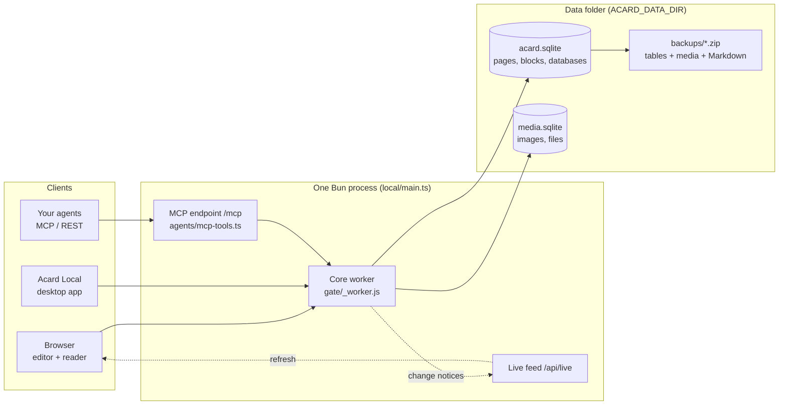

# Architecture

This page describes how Acard is built: where data is stored, how the server and clients talk, the block and
database model, and how backups and sync work. File paths point into this repository.

## Overview

- **One process.** `local/main.ts` starts `local/server.ts`, which runs the same core worker the hosted version
  uses (`gate/_worker.js`, bundled to `.build/acard-core.js` by `build.ts`) inside Bun. Local shims stand in for the
  Cloudflare bindings: a SQLite-backed workspace store, a key-value store for media, and static files from `dist/`.
- **One data folder.** `ACARD_DATA_DIR` holds `acard.sqlite` (pages, blocks, databases, settings), `media.sqlite`
  (images and attachments), the session secret, and `backups/`. Back up or move this folder and you have moved
  everything.
- **Thin clients.** Browsers load the static web app from `dist/`. The desktop app, Acard Local (`desktop/`), is a
  small Electron window that remembers a server address and opens it. It holds no data of its own.

## Server modes

| Mode | How | Who can reach it |
| --- | --- | --- |
| This machine only | default, `ACARD_HOST=127.0.0.1` | the local user |
| LAN / VPN | `ACARD_HOST=0.0.0.0`, `ACARD_PASSWORD`, `ACARD_ALLOWED_HOSTS` | anyone with the address and the password |
| Behind HTTPS | a reverse proxy such as Caddy in front | as above, over TLS |

The server refuses to listen on a non-loopback address without a password. Requests whose `Host` header is not in
`ACARD_ALLOWED_HOSTS` are rejected, which blocks DNS-rebinding attacks. Sign-in sets an HMAC-signed cookie; changing
the password signs everyone out.

## Content model

- **Pages** (`pages` table) form a tree through `parent` and `ord`. A page has a `kind`: a note, a database, or a
  database row.
- **Blocks** (`blocks` table) are the ordered contents of a page: `type`, `text`, `indent`, `checked` and a JSON
  `meta` for things like colors, column layout or image size. The editor (`editor-next/`) edits blocks; the reader
  (`block-html.js`) renders them to HTML.
- **Markdown** is the exchange format. `markdown-blocks.ts` is the one rule that turns Markdown into blocks, used by
  import, the API and agents; `notion-export.ts` turns blocks back into Markdown and HTML.
- **Databases** are real tables: `databases`, `db_properties` (typed columns), `db_rows`, `db_views` (table, board,
  gallery, list, calendar, timeline, chart), `db_templates`, and `db_relation_links` for two-way relations.
  Formulas are evaluated by `db-formula.js`.
- **Search** uses SQLite FTS5 tables kept current by triggers (`features/search-fts.js`).
- **Sharing** keeps hashed link tokens and per-page rules (`features/share.js`, `features/share-model.js`).

## Live updates

When a request changes content, `gate/live.ts` records which kinds of content and which pages changed. Open tabs
listen on `/api/live` and re-read only what changed through the normal, permission-checked APIs, so two people on
the same server see each other's edits without reloading.

## Agents

`agents/mcp-tools.ts` defines the MCP tools: list, read, create and update pages, edit single blocks, append to a page,
upload images, read and edit databases, tags and parts. The local server serves them at `/mcp` for agents on your
machine or network, and `agent-api.js` exposes the same operations as a REST API. `packages/acard-cli` bridges MCP over stdio and can pull and push pages as `.md` files.

## Backups and restore

`gate/archive.ts` defines one archive format for backup, restore and export: a zip with `manifest.json`,
`data/<table>.json` for every content table, `media/<id>` for every file, and `markdown/<slug>.md`, a readable copy of
each page. Secrets (token hashes, sign-in grants, share tokens) are never exported, so a backup handed to someone else
grants no access. `local/auto-backup.ts` writes one archive a day into `<data>/backups/` and keeps the newest copies.

## Optional cloud features

The local server can connect to a hosted Acard account to publish pages or keep an off-site backup
(`local/cloud.ts`), and to sync pages between several of your own machines (`local/sync.ts`, three-way merge in
`local/sync-merge.ts`; conflicting edits are kept as a separate copy, never dropped). These are off until you sign in.
`ACARD_CLOUD_URL` points them at another server, and an empty value turns them off entirely (`local/cloud-host.ts`).

## Performance

There is no front-end framework. `perf-budget.json` caps the size of the reader, the editor, the total bundle and
each lazily loaded feature, and `bun run build` fails when a cap is exceeded (`scripts/perf-budget.ts`).

## Optional Cloudflare deployment

The same core also runs on Cloudflare Workers with D1 or Postgres (`wrangler.toml`, `workers/`, `migrations/`). This
is how the hosted version runs; it is optional for self-hosters.
